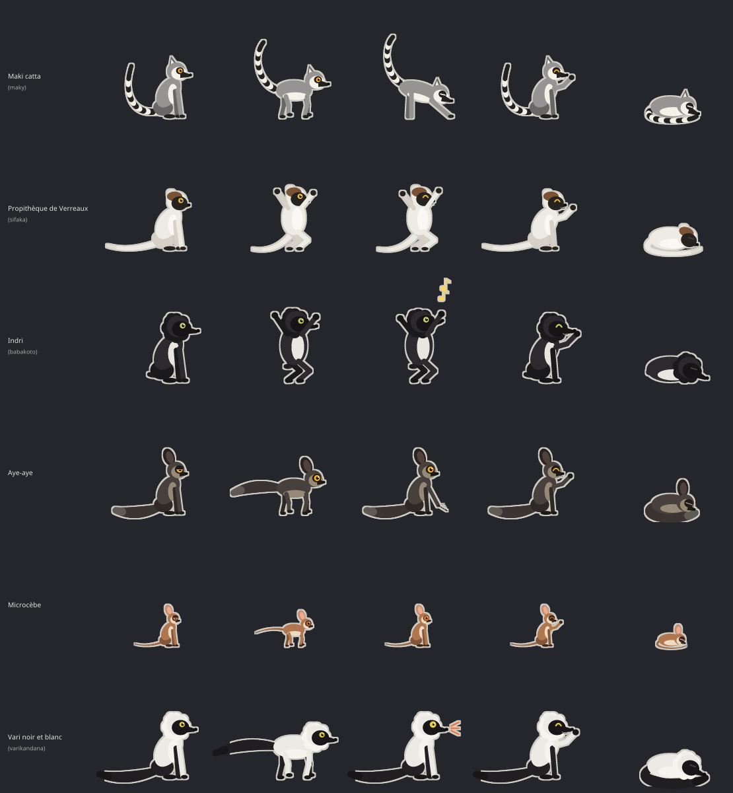
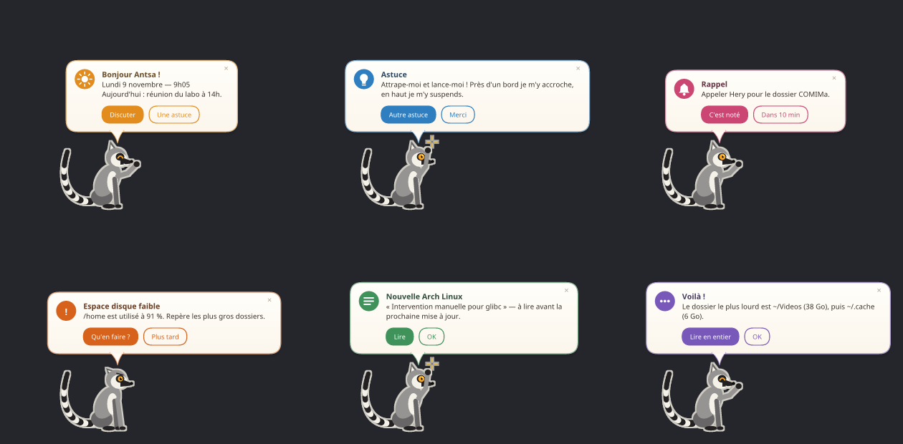
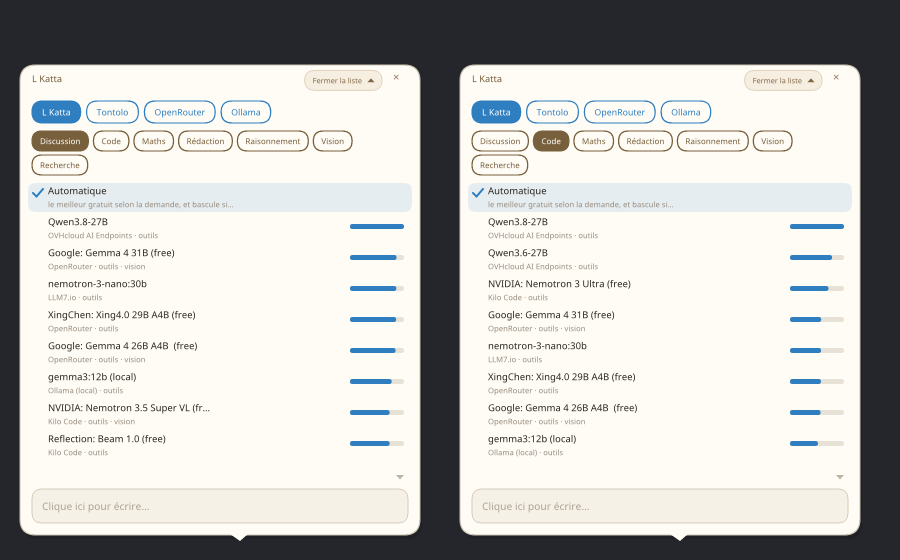

<h1 align="center">L Katta</h1>

<p align="center"><b>Lemur Kata — un petit lémurien de Madagascar qui vit sur ton bureau Linux.</b><br>
Il connaît <i>ta</i> machine, t'aide sans te déranger et se balade d'un écran à l'autre.</p>

<p align="center"></p>

Dans l'esprit du trombone des anciens Office, mais utile et discret. **Tout tient dans un
seul fichier** : le maki, son moteur d'IA et le choix des modèles. Le moteur, porté de
[Tontolo](https://github.com/raantss18/tontolo), choisit tout seul le meilleur modèle gratuit
pour chaque demande, **sans compte ni clé** ; les outils de maintenance viennent de
[mi-saina](https://github.com/raantss18/mi-saina).

## Six lémuriens au choix

| Espèce | Comment il bouge |
|---|---|
| **Maki catta** (maky) | à quatre pattes, queue annelée dressée ; s'étire au soleil |
| **Propithèque de Verreaux** (sifaka) | debout, par bonds de côté : il danse |
| **Indri** (babakoto) | le plus grand ; grands bonds debout, il chante |
| **Aye-aye** | lent, grandes oreilles, tapote avec son long doigt ; paupières lourdes le jour |
| **Microcèbe** | minuscule, trottine par à-coups, guette avec ses yeux énormes |
| **Vari noir et blanc** (varikandana) | collerette, longue queue noire, grands cris |

`/especes` dans sa bulle, puis `/regle espece sifaka` : il se transforme dans un nuage.

## Ce qu'il fait

- **Il vit sur l'écran, sans fenêtre** : il marche, bondit, fait pousser un arbre et y
  grimpe, escalade les bords, se suspend en haut puis se laisse tomber, se téléporte.
  Attrape-le et lance-le : il se redresse en l'air comme un chat.
- **Il laisse ta zone de travail libre** (bords gauche et droit), passe d'un écran à
  l'autre et retrouve sa place sur chaque bureau virtuel.
- **Des bulles qui ont du sens** : accueil selon le moment (rappels, alertes), astuces,
  rappels, alertes de santé, nouvelles d'Arch, réponses — chacune avec ses boutons
  (« Dans 10 min », « Qu'en faire ? », « Autre astuce »…) et sa réaction (il salue,
  lève la patte, s'inquiète, bondit de joie). Une caresse de la souris le rend content.
- **Discuter dans sa bulle** : clic sur lui. Fichiers, bilan de santé, applications,
  Internet, actualités, rappels, presse-papiers, bureaux virtuels…
- **Ton terminal** : il lance une commande dans un onglet Konsole visible (pour `sudo`,
  c'est toi qui tapes le mot de passe), lit ce qu'affiche ton terminal, y écrit.
- **Mails, agenda, contacts** : mails IMAP (non lus résumés, lecture sans les marquer lus),
  envoi après validation du texte complet ; agenda iCal ; contacts vCard.
- **Règles strictes** pour la machine et pour chaque utilisateur, appliquées par le code.
- **Se met à jour tout seul** (après accord) et **démarre avec la session** (réglable).
- **Léger** : un seul binaire, ~15 Mo de mémoire, aucune IA locale exigée.

<p align="center"></p>

## Installation

Le plus simple : l'**AppImage** d'une [release](https://github.com/raantss18/L-Katta/releases).

```bash
chmod +x LKatta-*-x86_64.AppImage
./LKatta-*-x86_64.AppImage installer   # copie dans ~/.local/bin, lanceur, démarrage de session
lkatta &
```

Ou l'archive `lkatta-*-x86_64-linux.tar.gz`, ou les sources :
`cargo build --release && ./target/release/lkatta installer` (AppImage : `scripts/appimage.sh`).

Prérequis : Wayland avec *layer-shell* (KDE Plasma, Sway, Hyprland…), `wl-clipboard` ;
pour les mails `curl` et `secret-tool` (libsecret). L'IA marche dès l'installation avec les
modèles gratuits sans clé ; une clé OpenRouter ou Ollama en local en ajoutent d'autres.

## Souris

| Geste | Effet |
|---|---|
| clic | ouvre / ferme la bulle de discussion |
| glisser-lâcher | l'attraper et le lancer |
| laisser la souris dessus | il est content |
| clic droit | mode discret |
| clic molette | un numéro au hasard |

Dans la bulle, clique dans le champ pour écrire : elle ne prend jamais le clavier d'elle-même.

## Choisir le modèle

Comme dans Tontolo : clic sur la pastille du modèle en haut de la bulle (ou `/modeles`).
Les modèles sont triés par qualité selon la catégorie (discussion, code, maths, rédaction…),
« Automatique » en premier : le moteur intégré choisit alors le meilleur modèle gratuit pour
chaque demande et bascule tout seul s'il est saturé. `lkatta catalogue` rafraîchit la liste.

<p align="center"></p>

## Réglages

Dans la bulle : `/reglages` montre tout, puis par exemple `/regle espece indri`,
`/regle zone libre`, `/regle moteur 2 modele <nom>` (`/modeles 2` liste les modèles),
`/regle conseils_h 0` (plus d'astuces), `/regle demarrage_auto non`, `/regle maj auto`.
En terminal : `lkatta reglages`, `lkatta regle …`, `lkatta especes`, `lkatta modeles 1 qwen`.

### Mails, agenda, contacts

```bash
lkatta compte-mail ton.adresse@gmail.com   # le mot de passe va dans le trousseau
```

Gmail demande un *mot de passe d'application* (compte Google › Sécurité). Agenda :
`/regle agenda <adresse iCal secrète>` (Google Agenda › Paramètres de l'agenda › Adresse
secrète au format iCal) ou un fichier `.ics`. Contacts : `/regle contacts ~/contacts.vcf`.

### Règles strictes

| Fichier | Pour qui |
|---|---|
| `/etc/lkatta/regles.md`, `/etc/lkatta/regles.toml` | tous les comptes (l'administrateur) |
| `~/.config/lkatta/regles.md`, `~/.config/lkatta/regles.toml` | toi |

Le texte des `regles.md` passe en tête du prompt système. Les `regles.toml` sont en plus
**appliqués par le code**, le plus strict l'emportant : dossiers interdits (`~/.ssh`,
trousseaux… par défaut), commandes interdites, outils désactivés, Internet / mails /
terminal autorisés ou non, et `confirmer_tout` pour tout faire valider.

### Les autres fichiers

- `~/.config/lkatta/config.toml` : tous les réglages.
- `~/.config/lkatta/prompt.md` : sa personnalité pour cet ordinateur.
- `~/.config/lkatta/machine.md` : la fiche de la machine (`lkatta profil`).
- `~/.config/lkatta/profil.md` : ce qu'il a retenu de toi (`/retiens …`).

## Commandes

```bash
lkatta dire "Coucou"           lkatta demander "quel dossier prend le plus de place ?"
lkatta rappel 18h30 appeler Hery          lkatta arbre | teleporter | grimper | ecran
lkatta discret on              lkatta etat | actualites | profil | quitter
lkatta maj                     lkatta demarrage on|off       lkatta catalogue
```

## Versions

Chaque chiffre va de 0 à 9 : 0.0.9 → 0.1.0, 0.9.9 → 1.0.0.
Feuille de route : [docs/TODO.md](docs/TODO.md) · analyse : [docs/ANALYSE.md](docs/ANALYSE.md).

## Licence

Apache-2.0, comme Tontolo. Voir [NOTICE](NOTICE).
